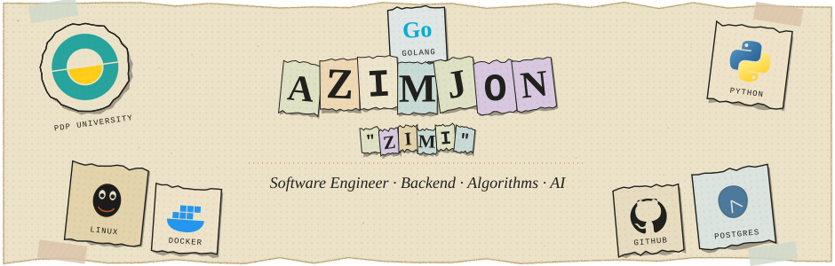
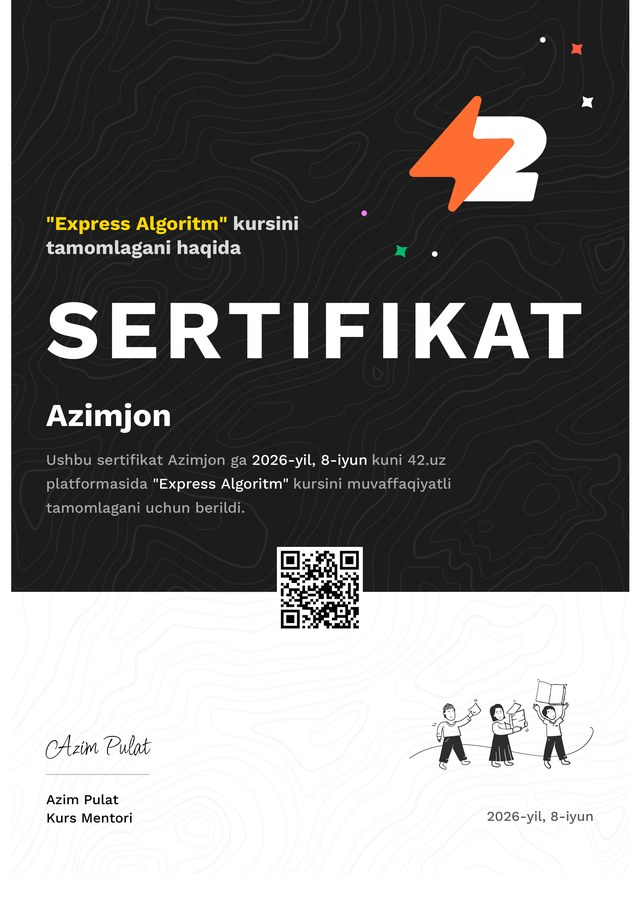

  

# Hi, I'm Azimjon 👋

I'm a student of Artificial Intelligence Solutions and Applications at PDP University. I enjoy building backend systems, solving algorithmic problems, and learning how software works under the hood. Linux is my primary working environment.

[Website](https://www.zimi.uz) · [LinkedIn](https://www.linkedin.com/in/zimidev) · [Telegram](https://t.me/zimidev) · [LeetCode](https://leetcode.com/u/zimi_dev/) · [Email](mailto:zimidevs@gmail.com)

## Featured projects

- **[BFS & DFS Lab](https://github.com/zimiDev/bfs_and_dfs_visualization)** — an interactive graph traversal visualizer with a grid editor and algorithm tests. [Live demo](https://zimidev.github.io/bfs_and_dfs_visualization/)
- **[CareTrack Clinic](https://github.com/zimiDev/for_class_work_medlink)** — a full-stack clinic management class project with a React frontend and Node.js API.
- **[LeetCode solutions](https://github.com/zimiDev/leetcode_solutions)** — Python solutions for data structures and algorithms practice.
- **[Portfolio](https://github.com/zimiDev/portifolio-)** — my personal website and developer journey.
- **[Navbatchi bot](https://github.com/zimiDev/navbatchi-bot-)** — a Telegram bot for duty schedules and reminders.

## Tools and interests

  

I work with Python, backend development, databases and Linux. I'm also learning Go, exploring AI engineering, and strengthening my understanding of data structures, algorithms and system design.

## Learning and problem solving

> I like understanding how things work, not just making them work.

My approach: read, understand, design, consider complexity, implement, test and learn. I completed the **42.uz Express Algorithm** course in June 2026.

View course certificate

 

## Activity

  

  

Learn → Build → Debug → Understand → Repeat

